  

  

## 🛠️ Tech Stack

  
  
  
  
  
  
  
  
  
  
  
  
  
  

## 🚀 Featured Projects

| Project | Description | Tech |
|---|---|---|
| [Lifestyle Management System](https://github.com/HaithamHD/lifestyle-management-system) | Laravel 12 web app for tasks, habits, journal and mood tracking with a REST API, Sanctum auth and an admin dashboard | Laravel, PHP, SQLite, Tailwind |
| [House Number Recognition (SVHN)](https://github.com/HaithamHD/svhn-digit-recognition) | CNN that recognizes digits in real street-view images — **87.92%** test accuracy | TensorFlow, Keras |
| [Heart Disease Prediction](https://github.com/HaithamHD/Heart-disease-prediction) | Random Forest model predicting cardiovascular disease from 70,000 patient records | scikit-learn, pandas |
| [Station Management System](https://github.com/HaithamHD/station-management-system) | Java Swing desktop app for a service station — EV charging, car wash and mechanical services with taxes, discounts and operation history | Java, Swing |
| [TF-IDF Search Engine](https://github.com/HaithamHD/tfidf-search-engine) | Text search engine that ranks documents by relevance using TF-IDF and cosine similarity | Python, NLTK, scikit-learn |

## 📊 GitHub Stats

  

  

## 🎯 Goals

- Build more practical AI and software projects
- Grow my skills in Machine Learning and Cybersecurity
- Keep improving my technical English

## 📫 Contact

Open to learning, collaboration, and building useful projects.

---

<i>“First, solve the problem. Then, write the code.” — John Johnson</i>

